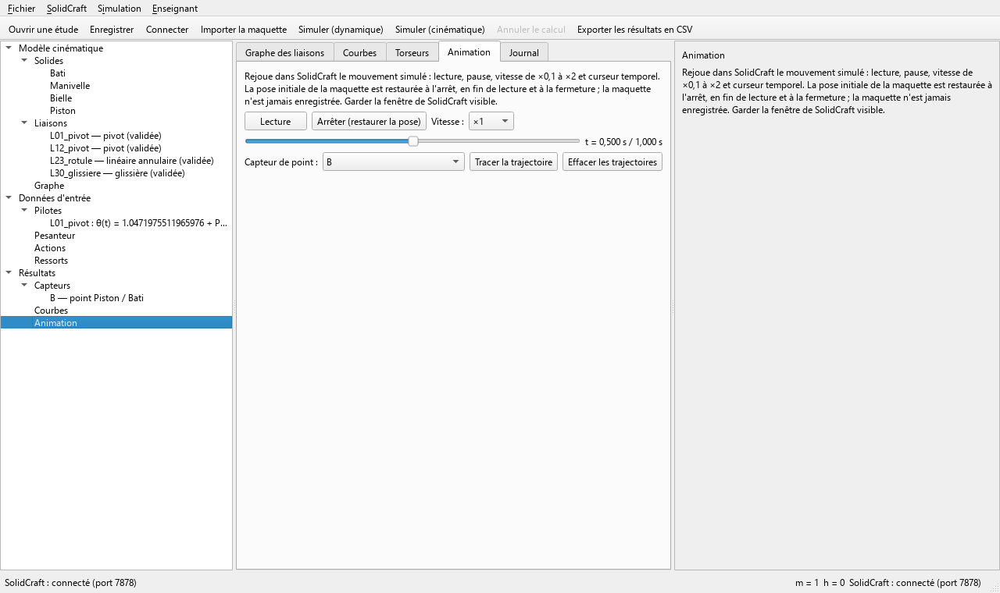

# Meca3D

Outil pédagogique de mécanique des solides indéformables. L'élève part d'une maquette
[SolidCraft](https://solidcraft.io), choisit les liaisons normalisées, obtient le graphe des liaisons,
la mobilité et l'hyperstatisme, simule le mécanisme avec [Exudyn](https://github.com/jgerstmayr/EXUDYN)
et lit les torseurs de liaison.

## Installation

1. Installer **SolidCraft 0.15.0** (séparément, Windows).
2. Télécharger le zip `Meca3D-<version>-windows-x64.zip` dans les
   [Releases](https://github.com/nbonzani/Meca3D/releases), le décompresser et lancer `meca3d.exe`
   (aucune installation de Python n'est nécessaire). `meca3d-cli.exe` donne la ligne de commande :
   `meca3d-cli simuler etude.meca3d --csv sortie.csv`.
3. Lancer SolidCraft avec le canal de contrôle : `solidcraft --control 7878` (ou laisser le port par
   défaut ; Meca3D lit le port courant dans le dossier de contrôle de SolidCraft). La fenêtre de
   SolidCraft doit rester visible pendant l'animation ; Meca3D la ramène si elle est réduite.

## Documentation et exemples

- **Guide utilisateur** : [docs/guide/Meca3D_Guide_utilisateur.pdf](docs/guide/Meca3D_Guide_utilisateur.pdf)
  (également livré dans le zip de l'exécutable).
- **Exemples** : le dossier [`exemples/`](exemples/) contient cinq études complètes, prêtes à simuler
  sans SolidCraft (bielle-manivelle, pendule simple, pendule double, réducteur à engrenage,
  vis-écrou), et leurs maquettes SolidCraft dans `exemples/maquettes/`. Premier essai :
  **Fichier → Ouvrir une étude…**, `exemples/bielle_manivelle.meca3d`, puis **Simuler (dynamique)**.

## Utilisation rapide

1. Ouvrir la maquette dans SolidCraft (solides et liaisons posés).
2. Dans Meca3D : importer la maquette, puis choisir pour chaque classe d'équivalence la liaison
   normalisée (pivot, glissière, rotule, …) ; le graphe, la mobilité m et l'hyperstatisme h se mettent
   à jour.
3. Saisir les actions : pesanteur, actions mécaniques, lois d'entrée sur les mobilités pilotées.
4. Lancer la simulation (dynamique ou cinématique), lire les courbes et les
   torseurs de liaison, exporter en CSV.
5. Rejouer le mouvement dans SolidCraft (lecture, pause, vitesse, trajectoires de points).

## Développement

Python 3.12 et [uv](https://docs.astral.sh/uv/).

    uv sync                         # environnement (jamais pip)
    uv run pytest -q                # tests (slow : -m slow ; SolidCraft réel : -m solidcraft)
    uv run ruff check . && uv run ruff format --check . && uv run pyright
    uv run python -m meca3d         # lancer l'interface
    uv run pyinstaller meca3d.spec --noconfirm   # exécutable : dist/meca3d/

Une étiquette `v*` déclenche `.github/workflows/release.yml` (construction, tests de l'exécutable,
Release avec le zip). Le déclenchement manuel du même workflow ne publie qu'un artefact. Voir
`docs/SPEC.md`, `docs/ARCHITECTURE.md`, `docs/PLAN.md`.

## Licence

GNU GPL version 3 ou ultérieure (fichier `LICENSE`). Les dépendances sont compatibles : voir
[docs/LICENCES.md](docs/LICENCES.md).

## Crédits

- **Decade**, de Thomas Paviot : source d'inspiration de la démarche pédagogique.
- **[Exudyn](https://github.com/jgerstmayr/EXUDYN)** (Johannes Gerstmayr, Université d'Innsbruck) :
  moteur de dynamique multicorps.
- **[SolidCraft](https://solidcraft.io)** : modeleur CAO piloté par son canal de contrôle.
- PyQt6, NumPy, NetworkX, SymPy, Matplotlib.
